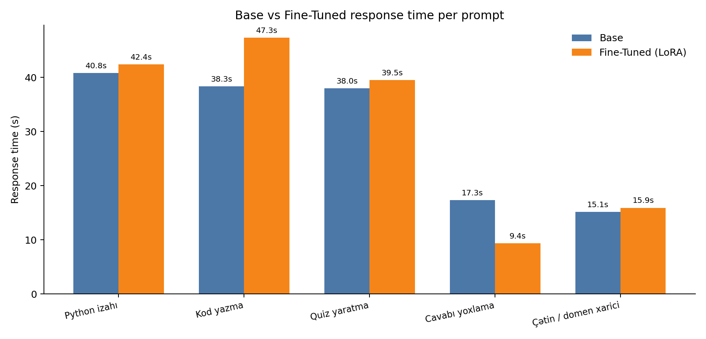

# Benchmark Results

Model: **Qwen/Qwen2.5-1.5B-Instruct** · adapter: `C:\Users\User\base-vs-finetuned-panel\adapters\qwen25-python-tutor`  
Device: **cpu** · dtype: **bfloat16** · torch 2.12.0+cpu · 12 CPU threads  
Settings: max_new_tokens=128, temperature=0.0

## 1. Load cost

| Step | Time |
|---|---|
| Tokenizer | 0.89 s |
| Base weights | 0.49 s |
| Adapter attach (`PeftModel.from_pretrained`) | 0.17 s |
| Total startup | 1.55 s |
| Adapter size | 2.09 MB |
| Trainable adapter parameters | 544,768 |
| Base parameters | 1,544,259,072 |
| Warm-up (2 variants, 2 tokens each) | 10.11 s |

## 2. Response time per prompt

| Prompt | Domain | Base (s) | Fine-Tuned (s) | Fərq | Base tokens | FT tokens | Base tok/s | FT tok/s |
|---|---|---|---|---|---|---|---|---|
| 1. Python izahı | in-domain | 40.8 | 42.4 | +1.6 s (+4.0%) | 129 | 128 | 3.16 | 3.02 |
| 2. Kod yazma | in-domain | 38.3 | 47.3 | +9.0 s (+23.4%) | 128 | 127 | 3.34 | 2.68 |
| 3. Quiz yaratma | in-domain | 38.0 | 39.5 | +1.5 s (+4.1%) | 128 | 128 | 3.37 | 3.24 |
| 4. Cavabı yoxlama | in-domain | 17.3 | 9.4 | -8.0 s (-46.0%) | 40 | 5 | 2.31 | 0.53 |
| 5. Çətin / domen xarici | out-of-domain | 15.1 | 15.9 | +0.8 s (+5.1%) | 30 | 34 | 1.98 | 2.14 |

## 3. Aggregate timing

| Variant | N | Ortalama (s) | Median (s) | Ort. tok/s | Ort. token | Ort. söz |
|---|---|---|---|---|---|---|
| Base | 5 | 29.9 | 38.0 | 2.83 | 91.0 | 32.2 |
| Fine-Tuned | 5 | 30.9 | 39.5 | 2.32 | 84.4 | 26.0 |




## 4. Full responses

### 1. Python izahı  
> Python-da list və tuple arasındakı fərqi yeni başlayan üçün izah et. Qısa kod nümunəsi ver.

<details open>
<summary><b>Base</b> — 40.8s, 129 token, 3.16 tok/s</summary>

~~~~text
Pythonda `list` və `tuple` əsasında bir çox özü var. Bu özü ilə qısa kod nümunəsi verir:

```python
# List
numbers = [1, 2, 3]
print(numbers)  # Output: [1, 2, 3]

# Tuple
coordinates = (4, 5)
print(coordinates)  # Output: (4, 5)

# İsimlər
names = ["Ali", "Veli"]
print(names[0])  # Output: Ali

# Dördün
~~~~

</details>

<details open>
<summary><b>Fine-Tuned</b> — 42.4s, 128 token, 3.02 tok/s</summary>

~~~~text
```python
# Listaların əsasında:
# 1. Dəyərlərdən ibarətdir.
# 2. İndeksli olmayan dəyişikliklər qalır.
# 3. Ekspektif bir dəyər olmayan dəyişikliklər qalır.

# Tupleların əsasında:
# 1. Dəyərlərdən ibarətdir.
# 2. İndeksli olmayan dəyi
~~~~

</details>

### 2. Kod yazma  
> while döngüsü ilə 1-dən 5-ə qədər ədədləri çap edən Python kodu yaz və hər sətri qısa izah et.

<details open>
<summary><b>Base</b> — 38.3s, 128 token, 3.34 tok/s</summary>

~~~~text
Pythonda while döngüsü, bir daxil edilmiş koşulun doğru olmasından ibarət bir döngü yaratmaq üçün istifadə edilir. Bu döngü, bir daxili koşul sağlayarsa daima döndürür.

İlk dəyərdə, `while` döngüsünü aça bilərsiniz:

```python
# While döngüsü başlama
i = 1

# Döngü başlama
while i <= 5:
    print(i
~~~~

</details>

<details open>
<summary><b>Fine-Tuned</b> — 47.3s, 127 token, 2.68 tok/s</summary>

~~~~text
```python
# While döngüsü ilə 1-dən 5-ə qədər ədədləri çap edən kod

i = 1 # başlangıç qiyməti
while i <= 5: 
    print(i) # 1-ci qiymət
    i += 1 # i yi artır
```
Bu kod, 1-ci qiymətinin 5-ci qiymətden az olmağı üçün `<=` ifadəsi kullanır. `i += 1` if
~~~~

</details>

### 3. Quiz yaratma  
> Python siyahıları mövzusunda 3 suallıq quiz yarat və cavab açarını sonda göstər.

<details open>
<summary><b>Base</b> — 38.0s, 128 token, 3.37 tok/s</summary>

~~~~text
Tabii, burada sizin istifadəçinin seçdiksiyini göstərmək üçün 3 qısa suallıq quiz yaratmağa çalışacağım:

1. **Quiz 1:**
   - Soru: "Python'da bir fonksiyonun ne zaman çağırılır?"
     - A) Fonksiyon adı ile çağırılır
     - B) Fonksiyon adı ve parametrelerle çağırılır
     - C) Fonksiyon adı ve parametrelerle çağırılır,
~~~~

</details>

<details open>
<summary><b>Fine-Tuned</b> — 39.5s, 128 token, 3.24 tok/s</summary>

~~~~text
1) Python dili nədir? 
   a) Aşağıdakı bütün cümlələri təsir edin.
      b) Cümlənin başqa bir cümləsi olub-olmadığına görə.
      c) Cümlənin başqa bir cümləsi olmaz-olub-olmadığına görə.
      d) Cümlənin başqa bir cümləsi olub-olmadığına görə, bu cümlənin başqa bir cüml
~~~~

</details>

### 4. Cavabı yoxlama  
> Cavabımı yoxla: `[3, 7, 8][1]` nəticəsi 8-dir. Düzdür?

<details open>
<summary><b>Base</b> — 17.3s, 40 token, 2.31 tok/s</summary>

~~~~text
Düzdür. `[3, 7, 8][1]` metodun cümlənin əsasında 7-ci elementi döndürür.
~~~~

</details>

<details open>
<summary><b>Fine-Tuned</b> — 9.4s, 5 token, 0.53 tok/s</summary>

~~~~text
Düzdür.
~~~~

</details>

### 5. Çətin / domen xarici  
> Bir marafonda ikinci yerdə gedən idmançını keçdin. İndi neçənci yerdəsən? Qısa cavab ver və səbəbini bir cümlə ilə izah et.

<details open>
<summary><b>Base</b> — 15.1s, 30 token, 1.98 tok/s</summary>

~~~~text
İndi üçüncü yerdədəsin. Marafa üçün üçüncü yerdədən geyinmişsin.
~~~~

</details>

<details open>
<summary><b>Fine-Tuned</b> — 15.9s, 34 token, 2.14 tok/s</summary>

~~~~text
İndi üçüncü yerdədəsən. Marafa 3-cü yerdə gedən idmançın keçdi.
~~~~

</details>


## 5. Bonus: merged model vs adapter-attached model

Merged build (`merge_and_unload` on a fresh base copy): **1.3 s**

| Prompt | Base s | Base tok | FT s | FT tok | Merged s | Merged tok |
|---|---|---|---|---|---|---|
| 1. Python izahı | 46.2 | 129 | 50.6 | 128 | 42.6 | 128 |
| 3. Quiz yaratma | 39.7 | 128 | 35.5 | 128 | 33.8 | 128 |

## 6. Human votes

| Choice | Votes |
|---|---|
| base | 1 |